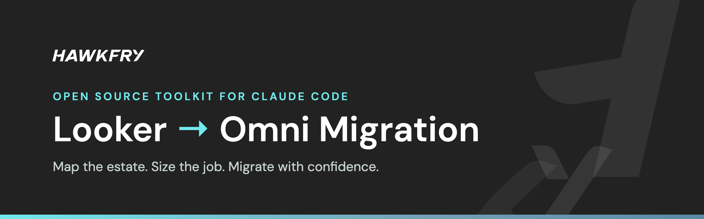
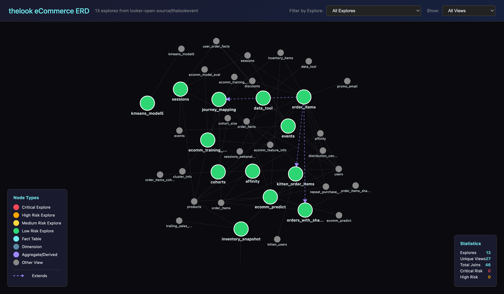
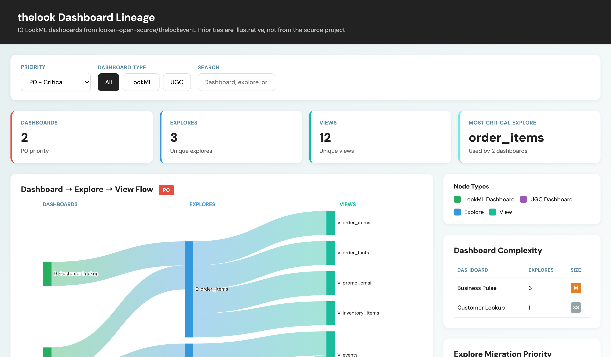
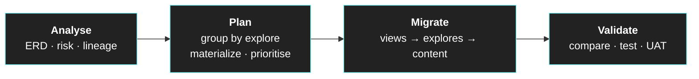

<p align="center">
  <a href="https://hawkfry.com"></a>
</p>

<p align="center">
  <a href="LICENSE"></a>
  <a href="https://docs.claude.com/en/docs/claude-code/overview"></a>
  <a href="https://omni.co"></a>
  <a href="https://hawkfry.com"></a>
</p>

<p align="center">
  <b>See your whole Looker estate before you move a single explore.</b><br>
  Claude Code skills that map explores, size the work and plan what to materialize, so your Omni migration starts with a plan instead of a guess.
</p>

---

## What You Get

<table>
  <tr>
    <td width="50%" valign="top">
      <a href="https://hawkfry-group.github.io/looker-omni-migration-toolkit/examples/sample-erd.html"></a>
      <p><b><code>/looker-erd</code></b><br>Every explore and the views it joins, scored by risk. Click a node to trace its relationships.</p>
    </td>
    <td width="50%" valign="top">
      <a href="https://hawkfry-group.github.io/looker-omni-migration-toolkit/examples/sample-sankey.html"></a>
      <p><b><code>/sankey-diagram</code></b><br>Dashboards flowing into explores and views, filtered by priority. Find the explores that carry the most content.</p>
    </td>
  </tr>
</table>

Both examples are real output, generated from Looker's public [thelook eCommerce](https://github.com/looker-open-source/thelookevent) project. Click either screenshot to open the live, interactive version: [ERD](https://hawkfry-group.github.io/looker-omni-migration-toolkit/examples/sample-erd.html) · [Sankey](https://hawkfry-group.github.io/looker-omni-migration-toolkit/examples/sample-sankey.html). Source details are in [examples/README.md](examples/README.md).

## Quick Start

### Install as a Claude Code Plugin

Run Claude Code inside your Looker repository and install the toolkit:

```
/plugin install looker-omni-migration --marketplace Hawkfry-Group/looker-omni-migration-toolkit
```

On older Claude Code versions, add the marketplace first:

```
/plugin marketplace add Hawkfry-Group/looker-omni-migration-toolkit
/plugin install looker-omni-migration@looker-omni-migration
```

### Install for Codex, Copilot, Gemini CLI and Other Agents

The skills follow the open `SKILL.md` format, so any [skills.sh](https://skills.sh) compatible agent can load them:

```bash
npx skills add Hawkfry-Group/looker-omni-migration-toolkit
```

### Or Clone and Run

You need [Claude Code](https://docs.claude.com/en/docs/claude-code/overview), your Looker repository (LookML), and optionally your Omni model repository.

```bash
# 1. Clone the toolkit
git clone https://github.com/Hawkfry-Group/looker-omni-migration-toolkit.git
cd looker-omni-migration-toolkit

# 2. Point it at your repositories
ln -s /path/to/your/looker-repo ./looker
ln -s /path/to/your/omni-repo ./omni

# 3. Start Claude Code
claude
```

Then run a skill:

```
/looker-erd ./looker/your_model
/materialization-review ./looker/your_model
/sankey-diagram ./dashboard-explore-mapping.md
```

The symlinks are gitignored, so your client code never ends up in this repo.

## The Toolkit

### Skills

| Skill | What It Does |
|-------|--------------|
| `/looker-erd` | Interactive ERD of explores and views, colour-coded by risk, with join counts and `extends` inheritance |
| `/materialization-review` | Decides which joins to pre-materialize in the warehouse and which to keep lazy, then suggests an Omni topic structure |
| `/sankey-diagram` | Dashboard → Explore → View lineage, with priority filters, LookML vs UGC toggles and an explore ranking |
| `looker-to-omni-migrator` | Converts LookML views and explores into Omni views, query views, topics and relationships, scoped by a CSV, with a review report per view |

### Migrating Views and Explores

`looker-to-omni-migrator` does the conversion once you have a plan. A CSV lists the fields to move in each phase; the skill writes `{view}.view.yaml` (or `{view}.query.view` for derived tables), `{explore}.topic.yaml` and `{explore}.relationships`, plus a migration report per view and explore that flags everything needing manual action. It needs Python 3.9 or later:

```bash
pip install -r skills/looker-to-omni-migrator/requirements.txt
```

Then ask Claude: *"Use the looker-to-omni-migrator skill to migrate the users view for phase 0, owner Team A."* Or run the CLI from the skill directory:

```bash
cd skills/looker-to-omni-migrator
python scripts/migrate.py --view users --phase 0 --owner "Team A" \
  --looker-repo examples/simple/thelook --csv examples/migration.csv --dry-run
```

See the [skill README](skills/looker-to-omni-migrator/README.md) for scope rules, flags and limitations.

### Agents

| Agent | What It Does |
|-------|--------------|
| `lookml-docs-expert` | Checks LookML syntax and patterns against the official Looker docs |
| `omni-docs-lookup` | Checks Omni modelling, admin and API questions against the official Omni docs |

### Queries

**`system_activity_tile_count.sql`** (shipped inside the `sankey-diagram` skill, linked from `queries/`) fills the gap LookML cannot. Run it against Looker System Activity to get tile counts, owners and legacy flags, and to find the user-built (UGC) dashboards that never appear in the repo. Read the header comment first: as written it returns only performance-flagged dashboards and stops at 100 rows.

### Templates

**`migration-advisory.md`** is a report template for writing up a migration assessment.

## How It Fits a Migration



1. **Analyse.** Run `/looker-erd` to see every explore and its risk. Run `/sankey-diagram` to see which dashboards depend on which explores. Run the System Activity query to catch everything the repo cannot show.
2. **Plan.** Group content by shared explores. Start with green (low risk) explores to prove the approach. Run `/materialization-review` to decide what moves into the warehouse first.
3. **Migrate.** Shared views first (`dim_date`, `dim_customer`), then explores in dependency order. If explore A extends B, migrate B first. `looker-to-omni-migrator` converts each view and explore and reports what needs manual work.
4. **Validate.** Compare source and target, then test content against the migrated topics.

## Reading the Output

### Risk Scoring

| Risk | Lines | Joins | Approach |
|------|-------|-------|----------|
| 🔴 Critical | > 500 | > 50 | Migrate last, test thoroughly |
| 🟠 High | > 200 | > 20 | Careful review, phased approach |
| 🟡 Medium | > 100 | > 10 | Standard migration |
| 🟢 Low | otherwise | | Migrate first, prove the approach |

An explore must exceed both thresholds to reach a tier.

### Materialization Review

- **Always-fire joins:** anything in `required_joins` costs you on every query
- **Shared derived tables:** derived tables reused across explores rebuild per query
- **Complex join conditions:** multi-field `sql_on` blocks worth flattening before the semantic layer
- **Keep-as-lazy list:** UNNEST expansion, simple foreign key joins, rarely used dimensions
- **Omni topic mapping:** a suggested topic structure built on the materialized tables

### Sankey Coverage

> [!WARNING]
> The Sankey can only map dashboards defined in LookML. Dashboards built in the Looker UI are not in the repo, and on a mature estate they often outnumber the LookML ones. Run `queries/system_activity_tile_count.sql` before treating the diagram as the full picture.

Add a `dashboard-complexity.csv` next to the generated HTML to override the calculated H/M/L/XS rating for any dashboard.

## Optional: Project Tracking and Agent Memory

A Looker migration runs for weeks and produces a lot of decisions: which explores were merged, which joins were materialized, which dashboards were retired rather than rebuilt. The toolkit does not store any of that for you. We recommend connecting one of these so Claude can read and record migration state across sessions:

- **Linear** (what we use): add the [Linear MCP server](https://linear.app/docs/mcp) and track each explore or dashboard group as an issue. Claude can pick up where the last session left off, link `/materialization-review` findings to issues, and update status as content moves.
- **Your own tracker or memory system:** any MCP server that gives Claude somewhere durable to read and write works the same way (Jira, GitHub Issues, Notion, or a plain `MIGRATION_LOG.md` committed alongside your Omni repo).

The bundled agents only get read and web tools. To let them write to your tracker, add those tools to the `tools:` line in `agents/*.md`.

## Contributing

Issues and pull requests are welcome. Open one on [GitHub](https://github.com/Hawkfry-Group/looker-omni-migration-toolkit/issues).

## License

[Apache License 2.0](LICENSE). Copyright 2026 Hawkfry Group Ltd; see [NOTICE](NOTICE).

---

<p align="center">
  <a href="https://hawkfry.com"><b>Hawkfry</b></a> is a consortium of independent data specialists.<br>
  We migrate BI estates, build semantic layers and put AI to work on real data.<br>
  <a href="https://hawkfry.com">hawkfry.com</a>
</p>
